<h1 align="center">
  <picture>
    <source media="(prefers-color-scheme: dark)" srcset="assets/scire-logo-dark.svg">
    
  </picture>
</h1>

The web page of SCIRE (Source-grounded Coaching Intelligence through Reverse Engineering): what a learner sees and runs in the browser.

SCIRE teaches from a learner's own material, asks questions, grades practice and schedules reviews. This repository holds the part that
runs in the browser. It talks to a SCIRE server over HTTP; the server is not part of this repository.

## The problem

Most learning material is written to be looked up, not to be learned from. A repository, a book as a PDF or a folder of notes has no
order to follow, no questions to answer and no way to tell what has stuck. Reading it feels like progress, yet most of it is forgotten
within days. A general chatbot does not fix that: its answers are not tied to what the learner is studying, and it can make things up.
Add the contribution rules, changelogs and translations that fill a typical repository, and a connection that comes and goes, and
studying from real material is harder than it should be.

## The solution

SCIRE turns the material a learner brings into a course that coaches them:

- **A path, not a pile.** The material is put in learning order. A software project is arranged as steps to rebuild it from scratch,
  which is also how to reverse engineer it. What does not teach (contribution rules, changelogs, translations of the README) is left out.
- **Answers from the material.** A question is answered from the learner's own passages, with the source named, and followed by a question
  that makes them think.
- **Practice that sticks.** Practice questions are made from the material and graded as the learner answers. Topics come back for review
  just before they would be forgotten, and a map shows what has been mastered.
- **Works offline.** The page keeps the material on the device, can run a small AI on the device, and sends progress back when the
  connection returns.
- **Respects the author.** Each material's license is shown, with plain advice on what to do first. With no license, the author keeps
  all rights.

SCIRE comes with one course ready to study: the public [System Design Primer](https://github.com/donnemartin/system-design-primer) by
Donne Martin (CC BY 4.0), pre-loaded as the default learning material. Learners add their own next to it: a GitHub repository, files or notes.

## Rebuilding a bundle

```bash
cd knowledge-map && npm ci && npm run build     # writes ../dist/knowledge-map.js
cd offline-model && npm ci && npm run build     # writes ../dist/offline-model.js
```

Commit the rebuilt `dist/` files together with the source change.

## License

Copyright (c) 2026 Tojoarisoa. All rights reserved.

This source is public so that it can be read. It is not licensed for reuse: it may not be copied, modified, redistributed or used in
another project without the author's written permission. Third-party code in `dist/` stays under its own licenses, reproduced in the
`THIRD-PARTY-LICENSES*.txt` files next to it.
